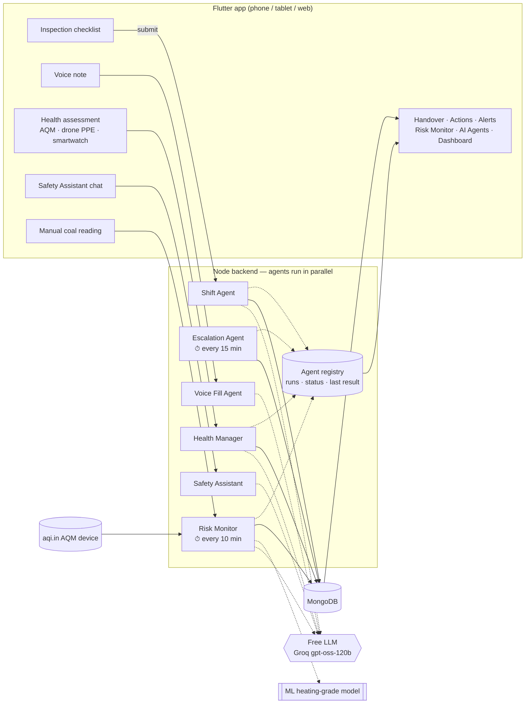
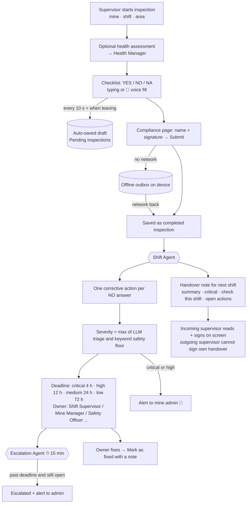
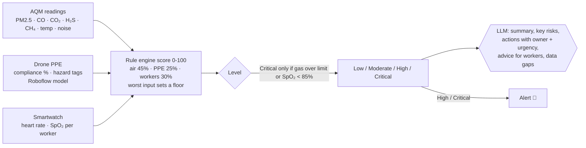
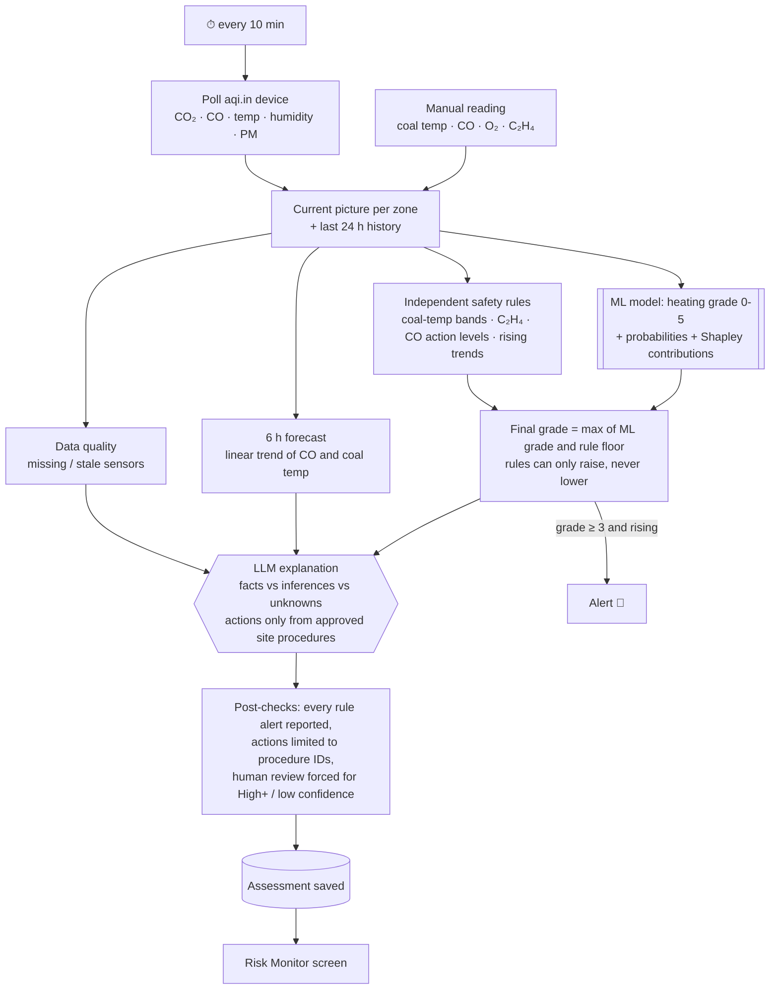
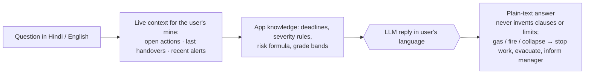

# AI Agents — How the System Works

The inspection app (Flutter, phone/tablet/web) talks to one Node/Express backend. Inside the backend, **six AI agents run independently and at the same time**: some are triggered by events (an inspection is submitted, a health check is done, a question is asked), others run on their own timers (escalation every 15 min, risk monitoring every 10 min). Every run is recorded in an agent registry, visible in the app under **Home → AI Agents**.

| Agent | Trigger | Does | Code |
|---|---|---|---|
| Shift Agent | event: inspection submitted | NO answers → corrective actions with owner + deadline, alerts, next-shift handover | `backend/src/Services/shift_agent.js` |
| Escalation Agent | every 15 min | overdue actions → escalated to mine admin + alert | `shift_agent.js → escalateOverdue` |
| Health Manager | event: health assessment | AQM + drone PPE + smartwatch → health risk score + suggestions | `backend/src/Services/health_manager.js` |
| Risk Monitor | every 10 min + new reading | AQM/coal readings → ML grade + safety rules + 6 h forecast → LLM explanation | `backend/src/Services/risk_monitor.js` |
| Safety Assistant | on demand (chat) | answers questions using live mine data | `backend/src/Controller/ai.controller.js → chat` |
| Voice Fill Agent | on demand (voice note) | spoken notes → checklist answers | `ai.controller.js → voice_fill` |

## 1. All agents at a glance

Every agent first computes the safety-critical numbers with **deterministic code** (rules, thresholds, ML); the LLM only writes explanations and suggestions and is never allowed to change a score. If the LLM is unavailable, each agent falls back to a rule-based text, so the safety logic keeps working.

## 2. Inspection → corrective actions (with deadlines) → handover

**Keyword safety floor** (cannot be lowered by the AI): gas, methane, CO, H₂S, fire, explosion, collapse, slope failure, inrush, flood, electrocution, brake failure → *critical*; slope, bench, crack, berm, parapet, dust, PPE, blast, water, gradient, speed → at least *high*.

## 3. Health Manager (AQM + PPE + smartwatch)

## 4. Risk Monitor (continuous spontaneous-heating monitoring)

Grades (coal-temperature hazard bands, Pei et al. 2024): 0 Safe < 50 °C · 1 Low 50-60 · 2 Moderate 60-100 · 3 High 100-120 · 4 Severe 120-230 · 5 Critical ≥ 230 °C.

**ML model** (`backend/ml/`): gradient-boosted trees trained on the 76 published lab rows of Guo et al. 2019 and Zhang & Chen 2025 plus synthetic rows interpolated along each coal's measured curve (with sensor noise, air dilution and random sensor dropout). Features: coal temperature, log CO, CO/CO₂, Graham's ratio (CO/ΔO₂), O₂ deficit, C₂H₄ present. Validation (each coal held out, gases only, no coal temperature): 54 % exact grade, 84 % within one grade; on the Longgu field data the grades rise in the right order. It is a screening aid built on lab data — retrain with the mine's own readings when available (`ml/.venv/bin/python ml/train.py`). See `backend/ml/README.md`.

**CO action levels** default to 100 / 190 ppm (from the Longgu field rows); they are not regulatory limits — set the mine's own values with `RISK_CO_HIGH_PPM` / `RISK_CO_SEVERE_PPM`. **Site procedures** in `backend/src/Services/site_procedures.js` are generic placeholders — replace them with the mine's approved SOPs.

## 5. Safety Assistant

## 6. Configuration

`backend/.env`: `LLM_API_KEY` (free Groq key; `LLM_BASE_URL` / `LLM_MODEL` to switch provider), `ROBOFLOW_API_KEY`, `AQI_EMAIL` / `AQI_PASSWORD` / `AQI_DEVICE_SERIAL`, optional `RISK_MONITOR_INTERVAL_MIN`, `RISK_CO_HIGH_PPM`, `RISK_CO_SEVERE_PPM`. Run everything locally with `./start.sh`.
